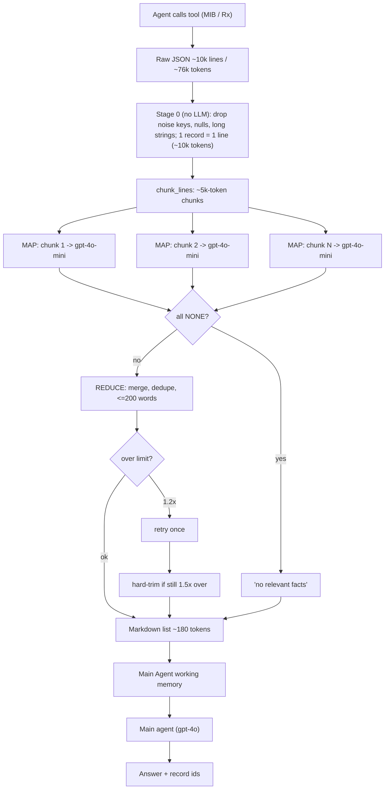

# Scratchpad Pruning with a Cheap LLM (Observation Compression Middleware)

Demo: [slm_observation_compressor.py](slm_observation_compressor.py)

## Problem

An agent calls tools against core systems (MIB, Rx). The JSON that comes back is huge (here ~10,000 lines, ~76k tokens) and mostly junk: audit logs, etags, HAL links, trace ids, raw HL7 blobs, routine records. If that goes straight into the agent's working memory (scratchpad):

- it exceeds or crowds the context window,
- every later turn re-sends it (cost and latency grow per step),
- the signal (a few risk flags) is buried, which hurts accuracy.

## Idea

Put a cheap model between the tool and the agent. It reads the raw observation and returns a ~200-word Markdown list of only what the task needs. Only that list enters working memory.

```
Tool result (10k lines) -> [compression middleware] -> ~200 words Markdown -> Main Agent
```

## Workflow



Editable source: [slm_observation_compressor.mmd](slm_observation_compressor.mmd).

### Stage 0: deterministic pre-compaction (no LLM)

`to_lines()` flattens the payload to one compact line per record (`path | {json}`):

- drops keys matching `NOISE_KEY` (`audit_log`, `etag`, `request_id`, `_links`, `trace`, `raw_*`, `pagination`, `debug`, ...),
- drops null/empty values, truncates strings over 160 chars.

Result: ~76k -> ~10k tokens at zero model cost. This is needed because the raw payload does not fit a small model's context.

### Stage 1: MAP (parallel)

`chunk_lines()` splits the lines into ~5k-token chunks. Each chunk goes to the compressor model with `MAP_SYS` plus the task. The model returns bullets `- <fact> [id, date, code]` for relevant records only, or `NONE`. Chunks run concurrently (`ThreadPoolExecutor`, 4 workers).

### Stage 2: REDUCE

All bullets are merged by one call (`REDUCE_SYS`): deduplicate, group under at most 3 headings (Diagnoses / MIB flags / Active Rx), keep every id, date and code, hard limit 200 words.

Length guard:

1. over 1.2x the limit -> one corrective retry,
2. still over 1.5x -> trim by whole bullets.

### Main agent

Gets only the compressed list as `WORKING MEMORY` and answers from it, citing record ids.

## Run

```bash
pip install openai
export OPENAI_API_KEY=sk-...          # PowerShell: $env:OPENAI_API_KEY="sk-..."

python slm_observation_compressor.py --dry-run      # payload + stage 0 stats, no LLM calls
python slm_observation_compressor.py                # full pipeline + main agent answer
python slm_observation_compressor.py --skip-agent   # compression only
python slm_observation_compressor.py -v             # log each map call
```

| Env var | Default | Purpose |
|---|---|---|
| `OPENAI_API_KEY` | required | auth (not needed for `--dry-run`) |
| `SLM_MODEL` | `gpt-4o-mini` | compressor model |
| `SLM_BASE_URL` | unset | any OpenAI-compatible endpoint |
| `AGENT_MODEL` | `gpt-4o` | main agent model |

Flags: `--chunk-tokens` (default 5000), `--word-limit` (default 200), `--save PATH` (dump the raw payload).

## What the demo measures

The synthetic payload hides 7 planted facts (3 MIB flags `MIB-0037/0091/0126`, 2 active Rx `RX-0078/0114`, `warfarin`, `cotinine`) among ~280 routine records.

- tokens: raw -> stage 0 -> compressed output,
- compressor calls, latency, tokens in/out,
- needle recall (`n/7`): did the compression keep the facts that matter.

Dry-run numbers: 10,247 lines / ~76k tokens raw -> 283 lines / ~10k tokens after stage 0.

## Caveats

- `NOISE_KEY` is a hardcoded list. For a real MIB/Rx schema, tune it. Dropping a field that matters is the main risk.
- Compression is lossy by design. Keep the raw payload retrievable (by id) so the agent can re-fetch details.
- The ~200-word limit is enforced by retry/trim, not guaranteed by the model.
- Token counting is `len/4`; swap in `tiktoken` for accuracy.
- The 7 needles are synthetic. Judge recall on your own data.
- The full pipeline has only been run against a local stub server, not the real OpenAI API.

## Related

- [phase3_pruning.py](phase3_pruning.py): observation pruning and rolling summarization.
- [scratchpad_pruning.py](scratchpad_pruning.py): rule-based scratchpad pruning (dead-ends, superseded facts, compaction).
