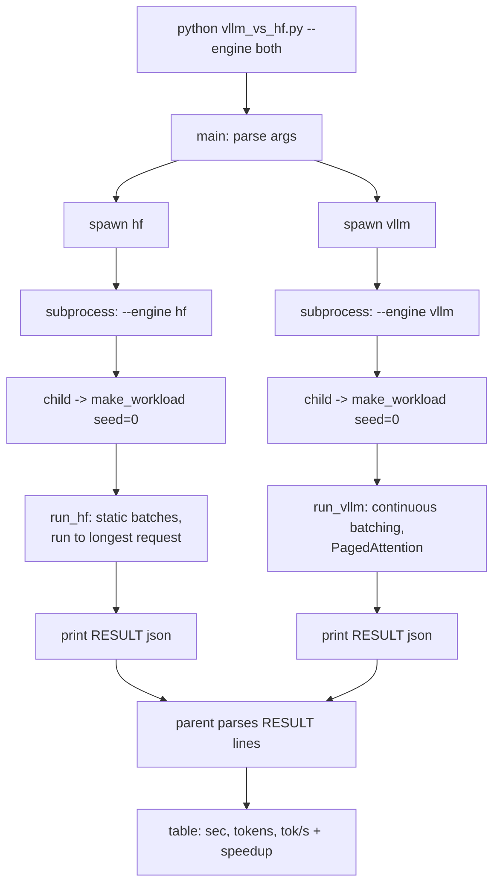

# vllm_vs_hf.py Workflow

Compares HF transformers (static batching) against vLLM (continuous batching + PagedAttention) on the same model, prompts and greedy decoding.

The script is an orchestrator. The parent process starts one subprocess per engine, so GPU memory is fully freed between runs. Each child runs the same workload and prints one `RESULT {json}` line that the parent parses.

Requires Linux + CUDA (WSL2 or Docker on Windows). vLLM has no native Windows build.

## Flow

```
                       python vllm_vs_hf.py  (--engine both)
                                    │
                                    ▼
                            main(): parse args
                                    │
                  ┌─────────────────┴─────────────────┐
                  ▼                                   ▼
        spawn("hf")                            spawn("vllm")
        subprocess.run(...)                    subprocess.run(...)
        (own process, own VRAM)                (own process, own VRAM)
                  │                                   │
                  ▼                                   ▼
   python vllm_vs_hf.py --engine hf        python vllm_vs_hf.py --engine vllm
                  │                                   │
                  ▼                                   ▼
          child(args)                          child(args)
                  │                                   │
                  ▼                                   ▼
   make_workload(n, seed=0)  ◄── identical prompts + max_toks ──►  make_workload(n, seed=0)
                  │                                   │
                  ▼                                   ▼
            run_hf(...)                         run_vllm(...)
   ┌───────────────────────────┐       ┌───────────────────────────────┐
   │ load fp16 model → cuda    │       │ LLM(model, mem=0.6, max_num_  │
   │ chat template + warmup    │       │   seqs=batch, eager?)         │
   │                           │       │ chat template + warmup        │
   │ for each chunk of `batch`:│       │                               │
   │   left-pad prompts        │       │ llm.chat(all prompts,         │
   │   generate(max_new =      │       │   per-request max_tokens)     │
   │     LONGEST in chunk)     │       │                               │
   │   count useful tokens     │       │ engine schedules each step:   │
   │   only (≤ own max_toks)   │       │  finished seq → slot refilled │
   └─────────────┬─────────────┘       └───────────────┬───────────────┘
                 │ print "RESULT {sec,tokens,...}"     │ print "RESULT {...}"
                 └──────────────────┬──────────────────┘
                                    ▼
                  parent: scan stdout for "RESULT " line
                  (no RESULT → print stderr tail, return None)
                                    │
                                    ▼
                    table: engine | sec | tokens | tok/s
                    + "vLLM speedup = tok/s ratio"
```

## Mermaid version



## Why the two engines differ

```
Static batching (HF), batch=4, max_toks = [16, 16, 16, 256]

 req A ████░░░░░░░░░░░░░░░░░░░░░░░░░░░░   ░ = slot idle, waiting for D
 req B ████░░░░░░░░░░░░░░░░░░░░░░░░░░░░
 req C ████░░░░░░░░░░░░░░░░░░░░░░░░░░░░
 req D ████████████████████████████████
       └──────── whole batch runs 256 steps ────────┘

Continuous batching (vLLM), same requests

 slot1 ████ E███████ ...                 finished → next request joins
 slot2 ████ F████ ...                    on the very next step
 slot3 ████ G███████ ...
 slot4 ████████████████████████████████
```

## Step by step

1. **`main()`** parses `--engine`, `--model`, `--n`, `--batch`, `--mem` and `--eager`. With `both` (the default), it calls `spawn()` twice. With a single engine, it runs `child()` directly.
2. **`spawn()`** re-runs this same file as a subprocess with `--engine X`. A subprocess is used so the GPU is fully released when HF exits. Otherwise vLLM would start with less free VRAM than it asked for.
3. **`make_workload()`** is seeded, so both engines get the same prompts. Output lengths are uneven (16 to 256 tokens). That is the case where static batching wastes the most.
4. **`run_hf()`** (naive baseline):
   - It processes fixed chunks of `batch` prompts.
   - Each chunk generates until its longest request is done.
   - Short requests keep padding while they wait.
   - Only real tokens count, so the padding is not credited.
5. **`run_vllm()`** (optimised engine):
   - It hands all requests to the engine at once.
   - The scheduler works one step at a time. When a sequence finishes, the next waiting request takes its slot.
   - PagedAttention stores the KV cache in small blocks, which cuts memory fragmentation.
   - CUDA graphs reduce launch overhead. `--eager` turns them off.
6. **The parent** reads the `RESULT` line from each child. If a child printed none, the parent prints the last 6000 characters of its stderr.
7. **Output** is a table of seconds, tokens and tokens/s, plus the speedup. The speedup is the tokens/s of vLLM divided by the tokens/s of HF.

## CLI flags

| Flag | Default | Purpose |
|---|---|---|
| `--engine` | `both` | `hf`, `vllm` or `both` |
| `--model` | `Qwen/Qwen2.5-0.5B-Instruct` | HF model id |
| `--n` | 64 | Number of requests |
| `--batch` | 16 | HF batch size and vLLM `max_num_seqs` |
| `--mem` | 0.6 | vLLM `gpu_memory_utilization`. Lower it on OOM. |
| `--eager` | off | vLLM `enforce_eager`: skips CUDA graphs, uses less memory |

## Fairness caveats

- HF and vLLM must use the same `--batch`. The script uses that one value for both.
- HF counts only useful tokens (up to each request's `max_tokens`), not padding.
- Greedy decoding on both, so output lengths are comparable.
