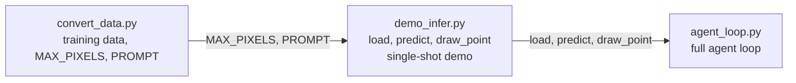
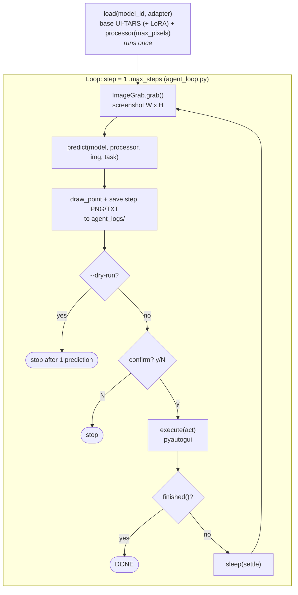
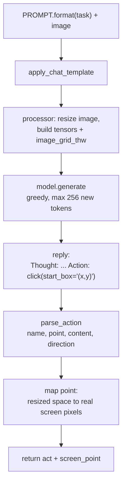

# Code Walkthrough: `load()` and the UI-TARS Agent Workflow

## 1. `load()` in `demo_infer.py`

```python
def load(model_id: str, adapter: str | None = None):
    model = Qwen2VLForConditionalGeneration.from_pretrained(
        model_id, torch_dtype=torch.bfloat16, device_map="auto")
    if adapter:
        from peft import PeftModel
        model = PeftModel.from_pretrained(model, adapter)
    processor = AutoProcessor.from_pretrained(model_id, max_pixels=MAX_PIXELS)
    return model, processor
```

`load()` builds the model and processor once, so the agent loop does not reload the 7B model on every step.

| Line | What it does |
|---|---|
| `Qwen2VLForConditionalGeneration.from_pretrained(model_id, ...)` | Loads the UI-TARS weights. UI-TARS uses the Qwen2-VL architecture, so this class fits. |
| `torch_dtype=torch.bfloat16` | Halves memory compared with fp32 (about 15 GB for 7B). |
| `device_map="auto"` | Places layers on the GPU and spills to CPU if VRAM runs out. |
| `if adapter:` | Runs only when `--adapter` is passed. |
| `PeftModel.from_pretrained(model, adapter)` | Stacks the fine-tuned LoRA weights on the frozen base model. The adapter adds the domain skill. `peft` is imported inside the `if`, so it is not needed without an adapter. |
| `AutoProcessor.from_pretrained(model_id, max_pixels=MAX_PIXELS)` | Loads the tokenizer and image preprocessor. `max_pixels` caps the screenshot resolution and **must equal the training value**, or coordinates drift. |
| `return model, processor` | Both are reused for every step. |

## 2. File roles



## 3. Whole pipeline



## 4. Inside `predict()`



## 5. Coordinate mapping

The model outputs `(x, y)` in the **resized** image, whose size is `(gw*14) x (gh*14)`. `gw` and `gh` come from `image_grid_thw`.

```
screen_x = x / (gw * 14) * W
screen_y = y / (gh * 14) * H
```

The result is passed to `pyautogui.click(screen_x, screen_y)`.

With `--coord norm1000` the model is assumed to output coordinates in 0-1000, so the formula becomes:

```
screen_x = x / 1000 * W
screen_y = y / 1000 * H
```

Which convention your checkpoint uses is not verified. Run `demo_infer.py` on a real screenshot. If the red crosshair lands in the wrong place, switch `--coord`.

## 6. Safety controls in the loop

| Control | Effect |
|---|---|
| `--dry-run` | Predicts one step and executes nothing. |
| Confirm prompt | Asks `execute? [y/N]` before each action. `--no-confirm` disables it. |
| `--max-steps` | Hard limit on steps (default 15). |
| pyautogui `FAILSAFE` | Moving the mouse into a screen corner aborts the run. |
| `agent_logs/` | Every step's annotated screenshot and raw reply are saved. |
