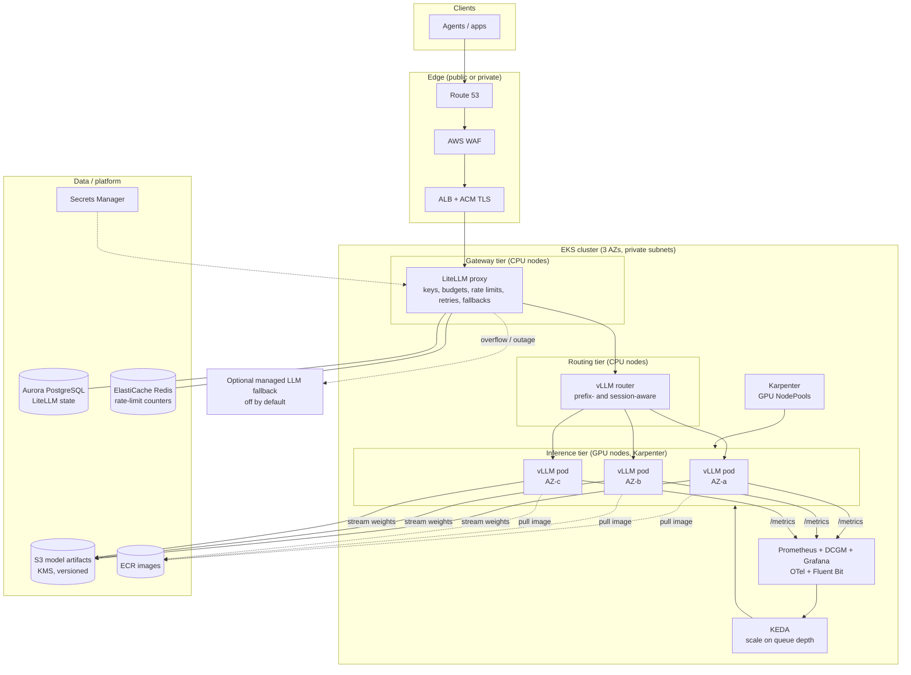

# Production Architecture: vLLM on Amazon EKS

| | |
|---|---|
| **Status** | Draft v2. Model, exposure, and DR scope decided (see section 13) |
| **Scope** | Self-hosted, OpenAI-compatible LLM inference for internal AI agents |
| **Target load** | ~1,000,000 LLM requests/day, hundreds of concurrent agents |
| **Supersedes** | The single-replica lab deployment currently in this folder (`eks.tf`, `k8s/`) |

> Numbers marked **(assumption)** are planning inputs, not measurements. Section 4 explains how to replace them with benchmark results before committing to a fleet size or a Savings Plan.

---

## 1. Goals, non-goals, and SLOs

### Goals
- Serve ~1M requests/day to hundreds of concurrent agents through a single OpenAI-compatible endpoint.
- Survive the loss of a node, an AZ, or a Spot reclamation without user-visible outages.
- Scale GPU capacity with demand, and keep cost per million tokens visible and controllable.
- Give every agent or team its own identity, key, rate limit, and budget.
- Roll out new model or vLLM versions with no downtime and fast rollback.

### Non-goals (for now)
- Multi-region or disaster recovery. Explicitly out of scope for now (see 10. Disaster recovery).
- Fine-tuning or training pipelines.
- Serving many different models at once. The design supports it but sizes for one primary model pool.

### Proposed SLOs (assumption, confirm with consumers)

| SLI | Target | Notes |
|---|---|---|
| Availability (non-5xx at gateway) | 99.9% monthly | About 43 min/month error budget |
| Time to first token (TTFT), p95 | under 2 s | Measured at the vLLM router |
| Inter-token latency, p95 | under 60 ms | Streaming feel |
| End-to-end latency, p95 (400 output tokens) | under 25 s | Agent loops are latency-sensitive in aggregate |
| Scale-out reaction | new GPU capacity serving within 8 min of sustained queue growth | Dominated by node start and model load, see 5.6 |

---

## 2. Workload assumptions

| Input | Value | Why it matters |
|---|---|---|
| Volume | 1,000,000 LLM calls/day (not user sessions) | Agents make many calls per task |
| Average input / output | 4,000 / 400 tokens **(assumption)** | Agent context is large (system prompt, tool schemas, history) |
| Prefix-cache hit rate | 60% **(assumption)** | Agents reuse long, stable prefixes. This is the biggest cost lever |
| Peak-to-average ratio | 5x **(assumption)** | Agent fleets burst |
| Average end-to-end latency | 8 s **(assumption)** | Used for concurrency (Little's law) |
| Streaming | Yes (SSE) | Affects LB timeouts and graceful shutdown |
| Tool calling | Yes | Needs the right `--tool-call-parser` for the model |
| Baseline model | `Qwen/Qwen2.5-7B-Instruct`, FP8 (**decided**) | Tool-call parser: `hermes`. Context length capped by `--max-model-len` (start at 16k) |

**Derived load**

- Average: 1,000,000 / 86,400 = **11.6 req/s**. Peak: ~**58 req/s**.
- Concurrent in-flight requests at peak: 58 req/s x 8 s = **~460**. This is the "hundreds of agents" figure.
- Tokens/day: 4.0B input, 0.4B output. Average output is ~4.6k tok/s and peak ~23k tok/s.
- Uncached prefill at peak (40% of input): ~92k tok/s.

---

## 3. Architecture overview

**Request path:** agent, then ALB (TLS, WAF), then LiteLLM (authenticate, rate-limit, budget), then vLLM router (choose the replica most likely to have the prefix cached and with spare capacity), then vLLM pod (generate, stream back).

**Control path:** vLLM exports queue depth and KV-cache usage, KEDA scales replicas, and Karpenter provisions GPU nodes for pending pods.

---

## 4. Capacity planning

### 4.1 Planning model

Per-GPU throughput is the main unknown. These figures are **assumptions** for an ~8B model in FP8 on 1x L40S with prefix caching, chunked prefill, and 64+ concurrent sequences:

| Metric | Assumed per-GPU |
|---|---|
| Aggregate decode throughput | ~3,000 tok/s |
| Uncached prefill throughput | ~15,000 tok/s |
| Usable KV cache | ~30 GB (48 GB x 0.9 minus ~9 GB weights and overhead) |

**Result for the baseline model (assumption-based)**

| Constraint | Peak need | GPUs at 100% utilization |
|---|---|---|
| Decode | 23k tok/s | ~8 |
| Prefill | 92k tok/s | ~6 |
| KV cache (460 seqs x ~4.4k tokens x ~57 KB/token for Qwen2.5-7B bf16, half in FP8) | ~58-116 GB | 2-4 |

Decode is the binding constraint. Planning for **60% target utilization** to leave headroom for scale-out lag:

- **Peak fleet: ~13 GPUs** (round to 12-16).
- **Baseline fleet (always on): 4-6 GPUs**, at least 2 per AZ across 2 AZs or 1 per AZ across 3, so one AZ loss does not take the service down.
- Everything between baseline and peak is autoscaled.

Larger models change this sharply. A 32B model needs roughly 4x the GPU-seconds per token and a 70B around 8-10x, so plan on H100-class (`p5`) or multi-GPU L40S (`g6e.12xlarge`) with tensor parallelism. This matters only if the model decision changes.

**FP8 hardware requirement:** FP8 needs NVIDIA Ada or Hopper GPUs (L4, L40S, H100). The A10G in `g5` instances (Ampere) has no FP8 support, so the lab's `g5.xlarge` is not a valid production target for this decision. Use `g6e` (L40S) as the baseline. Use either vLLM's online quantization (`--quantization fp8` on the BF16 weights) or a pre-quantized FP8 checkpoint stored in S3. A pre-quantized checkpoint gives faster, deterministic startup. Either way, run the quality eval from 4.2 against FP8 vs BF16 before rollout.

### 4.2 Validate before committing

Run this before buying a Savings Plan or reserving capacity:

1. Capture **real agent traces** (input/output token distributions, shared-prefix structure, burst shape).
2. Benchmark with `vllm bench serve` (or GuideLLM) against one pod per candidate GPU type, at the target concurrency and with the real prefix mix.
3. Record max sustainable req/s at the TTFT and ITL SLO, per GPU type. Replace section 4.1 inputs with these.
4. Repeat with and without prefix caching and with FP8 vs bf16 to quantify each lever.
5. Run a quality eval (task-level, not just perplexity) on any quantized or smaller candidate model.

### 4.3 GPU instance candidates

| Instance | GPUs | GPU memory | Fit |
|---|---|---|---|
| `g5.xlarge` | 1x A10G | 24 GB | Lab only. KV cache is too small for agent contexts |
| `g6.xlarge` | 1x L4 | 24 GB | Cheap, low throughput |
| `g6e.xlarge` | 1x L40S | 48 GB | **Baseline candidate** for 7-14B (FP8) |
| `g6e.12xlarge` | 4x L40S | 192 GB | 32-70B quantized, tensor parallel |
| `p5.48xlarge` | 8x H100 | 640 GB | Large models, highest throughput per node, needs capacity reservation |

Confirm availability and quotas in the target region and AZs first (section 11).

### 4.4 Indicative cost (order of magnitude, verify on the AWS pricing page)

For the 8B-class tier at roughly $1.9/hr per `g6e.xlarge` on-demand: baseline of 5 GPUs is about $7k/month. Autoscaled peak hours add to that. The total for the tier is in the **$8-15k/month** range before NAT, ALB, data transfer, and platform services. A 70B-class tier costs several times more. Levers, in order of impact: prefix caching, FP8 or quantization, right-sized model, Savings Plans on the baseline, Spot for burst, and offloading non-interactive work to batch.

---

## 5. Component design

### 5.1 Network and edge
- VPC across **3 AZs**. Nodes and pods in private subnets. Public subnets hold only the ALB and NAT.
- **VPC endpoints**: S3 (gateway), ECR API and DKR, STS, CloudWatch Logs, Secrets Manager. This keeps multi-GB image and weight pulls off the NAT gateway.
- NAT: one per AZ in production (a single shared NAT is an AZ-level single point of failure and a throughput bottleneck).
- vpc-cni with **prefix delegation** to avoid pod-IP exhaustion.
- **ALB** (AWS Load Balancer Controller) with an ACM certificate, WAF, and an **idle timeout raised for streaming** (ALB supports up to 4000 s). Replaces the current in-tree NLB, which has no TLS.
- **Public endpoint (decided).** Route 53 record, ACM certificate, and ALB in public subnets with a TLS 1.2+ security policy. Because the endpoint is internet-facing:
  - Only the ALB is public. LiteLLM, the router, vLLM, and the EKS data plane stay private.
  - **No anonymous access.** Every request needs a LiteLLM virtual key. Disable the unauthenticated paths (`/health` details, `/metrics`, admin UI) at the ALB or via listener rules.
  - **WAF** with AWS managed rule groups (Common, Known Bad Inputs, IP Reputation), a rate-based rule per source IP, and a request-body size limit. Add an IP allow list for known agent egress ranges if they are stable.
  - AWS Shield Standard is included. Evaluate Shield Advanced only if the endpoint becomes a DDoS target.
  - Gateway enforces `max_tokens`, request-size, and per-key RPM/TPM/budget caps. An unmetered public LLM endpoint is a direct cost-abuse risk (an attacker can burn GPU time).
  - Access logs on the ALB to S3, and alerts on spikes in 401/429 responses and spend per key.
- EKS API endpoint: private, or public restricted to known CIDRs.

### 5.2 Gateway tier: LiteLLM proxy
- Single OpenAI-compatible entry point. Provides **virtual keys per agent/team, RPM/TPM limits, budgets, usage and spend logs, retries, timeouts, and fallbacks**.
- Run **3+ replicas** across AZs on CPU nodes (HPA on CPU/RPS). State in **Aurora PostgreSQL**, rate-limit counters in **ElastiCache Redis**. Keep the DB off the hot path (async spend logging).
- Fallback chain: primary vLLM pool, then a managed API such as Bedrock for overflow or a pool outage. This is optional and off by default. It would serve a different model than Qwen2.5-7B, so enable it only after checking that agents tolerate the quality and tool-calling differences, and that the data-handling policy allows it.
- Key rotation and master key in Secrets Manager via External Secrets.
- At ~58 req/s peak this is comfortably within a replicated LiteLLM deployment, but load-test it with streaming and large bodies. Alternatives if it becomes a bottleneck: Envoy AI Gateway, Kong, or APISIX.

### 5.3 Routing tier: vLLM-aware router
Round-robin is wasteful for agents because identical prefixes land on different replicas and each recomputes them.
- Use the **vLLM production-stack router** (prefix/session-aware routing, queue-aware load balancing, Prometheus metrics), 2+ replicas on CPU nodes.
- Agents send a stable session or agent ID header so conversations stick to a replica with a warm cache.
- Alternatives to evaluate: Kubernetes **Gateway API Inference Extension** (endpoint picker) or **llm-d**. Treat router choice as swappable behind a Service. See ADR-3.

### 5.4 Inference tier: vLLM
- One **Deployment per model pool**, `RollingUpdate`, with a **PodDisruptionBudget**, **topology spread across AZs**, and a dedicated PriorityClass.
- Key flags to tune from benchmarks: `--enable-prefix-caching`, chunked prefill, `--max-num-seqs`, `--max-model-len`, `--gpu-memory-utilization`, `--kv-cache-dtype fp8`, and the model's `--tool-call-parser`.
- **Readiness** must pass only after the model is loaded and warm. A long `startupProbe` is acceptable because weights load from S3 (section 5.6).
- **Graceful shutdown:** `preStop` delay so the router stops sending traffic, and a `terminationGracePeriodSeconds` long enough to drain in-flight streams.
- Rollouts need spare GPU capacity: either `maxSurge: 1` with headroom or `maxUnavailable: 1` with N+1 capacity. Choose per pool size.
- Pin the vLLM image by **digest**, and pin the model by **revision/commit** in S3.
- Resource requests: set CPU and memory realistically. vLLM's host-side scheduler is CPU-sensitive, so starving it hurts throughput. Use a memory-backed `/dev/shm`.

### 5.5 Compute: Karpenter
- Replace the fixed managed GPU node group with **Karpenter NodePools**:
  - `gpu-baseline`: on-demand (covered by a Savings Plan or an On-Demand Capacity Reservation), `min` replicas pinned via KEDA.
  - `gpu-burst`: **Spot** with several instance types and all AZs, for autoscaled capacity. Spot interruptions are absorbed by gateway retries and replicas in other pools.
  - Optional `gpu-large`: for 32B+ tensor-parallel pools, backed by a **Capacity Block or ODCR** (H100 capacity is not reliably available on demand).
- Taint GPU nodes (`sku=gpu:NoSchedule`) and select them via label.
- EC2NodeClass uses the **EKS-accelerated AL2023 (or Bottlerocket NVIDIA) AMI**, pinned to a tested version, with a large gp3 root volume (or instance store) for the image and caches. Roll AMIs deliberately, not via `latest`.
- Alternative to evaluate: **EKS Auto Mode** if the team prefers less node management (check GPU, taint, and capacity-reservation support against requirements first).
- Run the **NVIDIA GPU Operator** or the device plugin plus **DCGM exporter** for GPU health and metrics.
- CPU nodes (system, gateway, router, observability) stay in a small managed node group spread across AZs.

### 5.6 Model and image delivery
Today's single EBS-backed PVC cannot be shared by replicas and is pinned to one AZ. Replace it:
- **Weights in S3** (versioned, SSE-KMS, private bucket, VPC endpoint), loaded with vLLM's **Run:ai Model Streamer** (`--load-format runai_streamer`). Every replica in every AZ reads the same artifact, with no per-pod volume.
- Models are **mirrored into S3 in CI** from the Hugging Face Hub (with license and checksum checks), so production never depends on `huggingface.co` or an HF token at runtime.
- **Images** in **ECR** (immutable tags, scan on push, pull-through cache for upstream). Reduce cold start with pre-pulled images on baseline nodes, SOCI lazy loading, or a custom AMI with the image baked in.
- **Cold-start budget: under 5 minutes** from node request to Ready (node boot, image, weights, CUDA graph capture). Measure it. It sets how much headroom autoscaling needs.

### 5.7 Autoscaling
- **KEDA** `ScaledObject` on Prometheus metrics from vLLM: `vllm:num_requests_waiting`, running requests, and KV-cache usage (and TTFT as a guard).
- `minReplicaCount` = baseline. `maxReplicaCount` = quota-backed ceiling.
- **Scale up fast, scale down slowly** (e.g. 10-15 min stabilization) because GPU nodes take minutes to return and cached prefixes are lost on termination.
- Karpenter adds nodes for pending pods and consolidates after scale-down, with `consolidateAfter` tuned so nodes are not churned.
- Run at about 60% target utilization (section 4.1) so the scale-up lag does not cause queuing.

### 5.8 Observability
- **Metrics:** Prometheus (self-hosted or Amazon Managed Prometheus) scraping vLLM, router, LiteLLM, DCGM, Karpenter, and KEDA. Grafana dashboards.
- **Key panels and alerts:** TTFT/ITL/e2e p50/p95/p99, queue depth, KV-cache usage and preemptions, prefix-cache hit rate, tokens/s, error rate by code, GPU utilization/memory/ECC/XID errors, node-start time, per-key spend and 429 rates.
- **Logs:** Fluent Bit to CloudWatch Logs or OpenSearch. **Redact prompts and completions by default** (or log only metadata) unless a retention and access policy exists.
- **Tracing:** OpenTelemetry from gateway to router to vLLM, with a request ID propagated to agents.
- **Alerts:** SLO burn-rate alerts (page), capacity alerts such as sustained queue growth or no spare GPU quota (ticket).

### 5.9 Security
- **Identity:** EKS Pod Identity (or IRSA) per workload with least-privilege IAM. Replaces the node-role shortcut used by the lab for the EBS CSI driver.
- **Secrets:** Secrets Manager with External Secrets Operator. No keys in manifests or Terraform state in plaintext.
- **Network:** default-deny NetworkPolicies. Only the router can reach vLLM, only LiteLLM can reach the router, and only the ALB can reach LiteLLM.
- **Data at rest:** KMS on S3, EBS, RDS, and Redis. **In transit:** TLS at the ALB, and mTLS in-cluster if required by policy.
- **Supply chain:** images by digest, ECR scanning, model checksums, signed artifacts if required.
- **Abuse controls:** WAF rate rules, per-key quotas, request-size and `max_tokens` caps at the gateway.
- **Audit:** CloudTrail, EKS audit logs, LiteLLM request metadata. Document data-handling for prompts (they can contain sensitive data).

---

## 6. Scaling behavior and failure modes

| Event | Expected behavior | Mitigation |
|---|---|---|
| Traffic burst | Queue depth rises, KEDA adds replicas, Karpenter adds nodes (~5-8 min) | Baseline plus headroom, gateway rate limits shed excess (429 with `Retry-After`) |
| vLLM pod crash / OOM | Router stops routing (readiness), Deployment restarts it | Conservative `--gpu-memory-utilization`, `max-num-seqs`, alerts on restarts |
| Node loss / Spot reclaim | In-flight streams on that pod fail | Client and gateway retry on another replica, Spot only for burst, PDB and spread |
| AZ outage | Lose roughly 1/3 of capacity | Baseline sized to carry core load with one AZ down (N+1 across AZs), burst quota in other AZs |
| GPU quota or capacity exhausted | Pods stay Pending | Pre-approved quotas, multiple instance types (`g6e`, `g6`) and AZs, ODCR for critical capacity |
| Bad model or vLLM release | Quality or error regression | Canary pool (e.g. 5% traffic via router/gateway weights), rollback by image digest, automated smoke evals |
| LiteLLM or Redis/DB outage | Gateway degraded | Replicated gateway, Multi-AZ Aurora and Redis, fail-open vs fail-closed policy decided explicitly |
| S3 or ECR unavailable | New pods cannot start (existing keep serving) | Keep baseline pods running, pre-pulled images, regional endpoints |

---

## 7. Deployment and operations

### 7.1 Infrastructure as code
Terraform, split into modules and state files that change at different rates:

| Stack | Contents |
|---|---|
| `network` | VPC, subnets, NAT, VPC endpoints |
| `cluster` | EKS, system node group, add-ons, Pod Identity, KMS |
| `platform` | Karpenter, KEDA, LB Controller, GPU Operator/DCGM, External Secrets, Prometheus/Grafana |
| `data` | S3 model bucket, ECR, Aurora, ElastiCache, Secrets Manager |
| `workloads` (Helm/Kustomize via GitOps) | LiteLLM, router, vLLM pools, NetworkPolicies, ScaledObjects |

Remote state (S3 with locking), per-environment variables (`dev`, `staging`, `prod`), and `terraform plan` in CI.

### 7.2 Delivery
- **GitOps** (Argo CD or Flux) for workloads. Terraform for infrastructure.
- Model release flow: new model into S3 (new prefix/revision), then canary pool, then eval gate (quality plus latency), then weighted shift, then retire old pool.
- Staging environment with the same topology but a small fleet. Load tests run there first.

### 7.3 Operations
- Runbooks: scale-up failures, quota requests, node replacement, rollback, GPU XID errors, cache-cold recovery.
- On-call tied to SLO burn-rate alerts.
- Quarterly review of cost per million tokens, GPU utilization, and model alternatives.

---

## 8. Cost controls
1. Prefix caching and a stable prompt prefix in agents (largest lever).
2. FP8 weights and KV cache, validated by evals.
3. Smallest model that meets quality, with a router/gateway that sends easy calls to a smaller pool.
4. Savings Plan or reservation only for the **measured** baseline. Spot for burst only.
5. Move non-interactive agent work to an async/batch path (SQS plus a batch pool) to flatten peaks.
6. VPC endpoints to cut NAT data charges, per-key budgets, and spend dashboards.

---

## 9. Architecture decision records

| # | Decision | Choice | Alternatives and why not (now) |
|---|---|---|---|
| ADR-1 | Inference engine | **vLLM** | SGLang (strong prefix reuse, already in this repo, revisit after benchmarks), TGI, TensorRT-LLM (higher ops cost) |
| ADR-2 | Compute scaling | **Karpenter** with baseline and Spot NodePools | Managed node groups plus Cluster Autoscaler (slower, less flexible for GPU mix), EKS Auto Mode (evaluate) |
| ADR-3 | Request routing | **vLLM production-stack router** | Gateway API Inference Extension / llm-d (more standards-based, newer, evaluate), plain Service (loses cache locality) |
| ADR-4 | Gateway | **LiteLLM** | Envoy AI Gateway, Kong, custom. LiteLLM gives keys, budgets, and fallbacks quickly |
| ADR-5 | Model storage | **S3 plus Run:ai Streamer** | EBS PVC per pod (not shareable, zonal), EFS (slower), FSx for Lustre (fast but costs more, consider if S3 streaming is too slow) |
| ADR-6 | Ingress | **ALB with ACM and WAF** | NLB (no TLS/WAF at L7), API Gateway (streaming and timeout limits) |
| ADR-7 | Autoscaling signal | **Queue depth and KV-cache usage via KEDA** | CPU/GPU utilization (poor proxy for LLM load) |

---

## 10. Disaster recovery (deferred)

Region-level DR is **out of scope** for the first production release (decision recorded in section 13). What remains in scope:

- **Within a region:** multi-AZ is the baseline (section 6).
- Stateless tiers (router, vLLM) need no backup. Back up Aurora (LiteLLM keys and spend) with point-in-time recovery, enable S3 versioning on the model bucket, and keep Terraform state versioned. Everything else can be rebuilt from Terraform and Git.
- **Accepted risk:** a full regional outage means the service is down until the region recovers or the stack is rebuilt elsewhere. Rebuild time is dominated by GPU quota and capacity in the new region, so it is not predictable.
- **Revisit when** the service becomes business-critical. The path is a warm-standby cluster in a second region from the same Terraform, S3 cross-region replication for model artifacts, and Route 53 failover.

---

## 11. Prerequisites and risks

| Risk | Impact | Action |
|---|---|---|
| **GPU service quotas** (On-Demand and Spot G/P vCPU) default to very low values | Cannot launch the fleet | Request increases now, per region and per family. Approval can take days |
| GPU capacity unavailable in an AZ | Pending pods, slow scale-out | Multiple instance types and AZs, ODCR or Capacity Blocks for baseline and large models |
| Throughput assumptions are wrong | Under- or over-provisioned | Benchmark first (section 4.2) |
| Agent prompt design defeats prefix caching | Costs 2-3x the plan | Standardize prompt prefix, include the session ID header |
| Quantization hurts quality | Task regressions | Eval gate before rollout |
| Prompt and PII exposure in logs | Compliance | Redaction by default, retention policy, access control |
| Operational load of self-hosting | On-call burden | Runbooks, GitOps, automation of routine recovery |
| Public endpoint abused (cost or DDoS) | GPU time burned, outage | Mandatory keys, WAF rate rules, per-key budgets, spend alerts (section 5.1) |

---

## 12. Phased delivery plan

| Phase | Outcome | Exit criteria |
|---|---|---|
| **0. Benchmark and quotas** (1 wk) | GPU quotas requested, `g6e` throughput for Qwen2.5-7B FP8 measured, FP8 vs BF16 quality checked | Section 4 inputs replaced with measured data |
| **1. Foundation** | Multi-AZ VPC with endpoints, EKS, remote state, Karpenter, S3 and ECR, Pod Identity | Single vLLM replica serving from S3 over TLS in staging |
| **2. Platform** | Router, LiteLLM, Redis/Aurora, KEDA, observability, NetworkPolicies, WAF | Multi-replica autoscaling works under synthetic load, dashboards and alerts live |
| **3. Hardening** | Load test at 2x peak, failure drills (pod, node, AZ, Spot), abuse tests against the public endpoint, security review, runbooks | SLOs met under load, drills pass, security sign-off |
| **4. Production rollout** | Canary traffic, then full traffic | 2 weeks within SLO, cost per M tokens reported |
| **5. Optimize** | Prefix and quantization tuning, reservations, evaluate SGLang, GIE/llm-d, EKS Auto Mode | Cost and latency targets met |

---

## 13. Decisions and remaining open items

### Decided

| # | Topic | Decision |
|---|---|---|
| 1 | Model | `Qwen/Qwen2.5-7B-Instruct` in FP8. Requires Ada/Hopper GPUs, so `g6e` (L40S) is the baseline |
| 2 | Exposure | **Public endpoint**: ALB + ACM + WAF, mandatory per-key auth, strict rate limits (section 5.1) |
| 3 | Token lengths and traffic shape | Use the planning assumptions in section 2 (4,000 in / 400 out, 60% cache hit, 5x peak). Re-validate with real traces once available |
| 4 | Disaster recovery | Deferred. Multi-AZ only (section 10) |
| 5 | Compute scaling | Karpenter (ADR-2). EKS Auto Mode stays an optimization-phase option |

### Still open (do not block Phase 0-1)

1. **Domain name** for the public endpoint and who controls its DNS (needed for ACM and Route 53).
2. **Compliance and data residency:** AWS region, PII in prompts, log retention, audit requirements.
3. **Budget envelope** and whether Savings Plans or capacity reservations are allowed.
4. **Tenancy:** number of agent teams or clients, per-team budgets, chargeback.
5. **Latency SLOs:** confirm the targets in section 1 and whether some agents are batch-tolerant.
6. **Tooling preferences:** Argo CD vs Flux, managed vs self-hosted Prometheus.
7. **Managed-API fallback:** whether the overflow path to a different model is acceptable (section 5.2).
